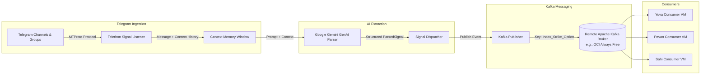

# Telegram Signal Producer

An asynchronous, AI-powered trading signal ingestion and parsing engine for Indian derivatives (NIFTY, BANKNIFTY, SENSEX, FINNIFTY).

The **Signal Producer** monitors designated Telegram channels and private groups using the MTProto protocol via **Telethon**, uses **Google Gemini 2.5 / 3.8 Flash** with conversational memory context to parse free-form Hindi/English trading instructions into strictly typed JSON trading events, and publishes validated events to **Apache Kafka**.

---

## Architecture



### Core Architecture Highlights
- **Telethon MTProto Client**: Directly streams new messages, edits, and pinned updates with millisecond latency.
- **Context-Aware Gemini Parsing**: Maintains a sliding memory window of the last several channel messages. This enables accurate interpretation of short follow-up messages like *"Exit now"*, *"Cost to cost exit"*, *"SL modified to 220"*, or *"Book 50% profit"*.
- **Pure Cloud Decoupling**: Connects directly to an external/remote Kafka broker (e.g. OCI Always Free instance). No local Docker containers or ZooKeeper overhead are required on the Producer VM.

---

## Signal Extraction & Kafka Event Schema

Every validated signal is published to Kafka topic `kotak_trading_signals` keyed by its contract symbol (`<INDEX>_<STRIKE>_<OPTION_TYPE>`, e.g. `NIFTY_23700_CE`).

### Sample Published Kafka Message
```json
{
  "is_trading_signal": true,
  "signal_type": "NEW_ORDER",
  "action": "BUY",
  "index": "NIFTY",
  "strike_price": 23700,
  "option_type": "CE",
  "order_condition": "ABOVE",
  "entry_price": 28.0,
  "trigger_price": 28.0,
  "stop_loss": 18.0,
  "target": [38.0, 48.0, 60.0],
  "target_expiry": null,
  "reasoning": "Breakout buy order for Nifty 23700 Call above 28 with 3 targets",
  "raw_message": "Nifty 23700 ce abv 28 tgt 38/48/60 sl 18",
  "timestamp": "2026-11-07T04:11:18+00:00",
  "_meta": {
    "event_id": "6c075c99-c6b4-4c8f-bdfc-7fcf6730aaaa",
    "published_at": "2026-11-07T04:11:18.167310+00:00",
    "source": "telegram_gemini_extractor"
  }
}
```

### Supported Signal Types & Instructions

| Signal Type | Example Telegram Message | Resulting Action |
| :--- | :--- | :--- |
| `NEW_ORDER` | `NIFTY 24500 CE ABV 250 SL 210 TGT 280/310` | Places buy order above 250 with SL 210 and staged targets. |
| `MODIFY_ORDER` | `Modify SL to 230` or `Trail SL cost to cost` | Updates protective stop-loss to revised price. |
| `EXIT` | `Exit NIFTY 24500 CE` or `Square off full` | Immediately closes active position at Market price. |
| `CANCEL` | `Cancel Nifty order` or `Ignore call` | Cancels pending entry order if not yet filled. |

---

## Configuration Reference (`.env`)

Create your `.env` file from `deploy/deploy.env.example` in the project root:

| Variable | Description | Example |
| :--- | :--- | :--- |
| `TELEGRAM_API_ID` | Telegram API App ID from [my.telegram.org](https://my.telegram.org) | `12345678` |
| `TELEGRAM_API_HASH` | Telegram API App Hash | `0123456789abcdef...` |
| `TELEGRAM_PHONE` | Account phone number with country code | `+919876543210` |
| `TELEGRAM_SESSION_NAME` | MTProto session file name | `kotak_trader_session` |
| `TELEGRAM_CHANNELS` | Comma-separated channel IDs or usernames to monitor | `-1002105432724,8945503479` |
| `GEMINI_API_KEY` | Google Gemini API Key | `AIzaSy...` |
| `GEMINI_MODEL` | Google Gemini model identifier | `gemini-2.5-flash` |
| `KAFKA_BOOTSTRAP_SERVERS` | Remote Kafka broker host:port | `129.225.75.71:9092` |
| `KAFKA_TOPIC_SIGNALS` | Kafka topic to publish events | `kotak_trading_signals` |

---

## Telegram Authentication & Local Testing

### 1. One-Time Interactive Telegram Login
Before starting the systemd service on a new machine or VM, authenticate once interactively:

```bash
# Activate virtual environment
source .venv/bin/activate

# Launch interactive login CLI
python main.py --login-telegram
```
- Enter your phone number with country code.
- Enter the login code received in your Telegram application.
- Enter your 2FA Cloud Password (if enabled).
- The credentials will be saved locally to `kotak_trader_session.session`.

### 2. Testing Gemini Parsing Locally
Verify Gemini extraction and JSON output without publishing to Kafka:
```bash
python main.py --test-signal "Nifty 23700 ce abv 28 tgt 38/48/60 sl 18"
```

---

## Automated Deployment (GitHub Actions)

Deployments are automated via [`.github/workflows/deploy.yml`](.github/workflows/deploy.yml) on push to `main` (or via manual **Run workflow** trigger).

### GitHub Secrets Configuration
Configure these in **Settings $\rightarrow$ Secrets and variables $\rightarrow$ Actions**:

| Secret / Variable Name | Description |
| :--- | :--- |
| `GCP_VM_HOST` | Public IP address of the Signal Producer VM |
| `GCP_VM_USER` | SSH username (e.g., `pawanbudati`) |
| `GCP_VM_SSH_KEY` | Private SSH deployment key |
| `GCP_VM_KNOWN_HOSTS` | Known hosts entry containing public key of the VM |
| `LOG_CLEANUP_CRON` *(Optional)* | Custom cron schedule for log cleanup & restart (defaults to `0 8 * * *`) |

### Key Deployment Features:
1. **Zero Docker Footprint**: Runs natively on Python with low CPU/RAM footprint, connecting directly to remote Kafka.
2. **Self-Healing Dependencies**: Auto-installs `python3-venv` and `python3-pip` via `apt` if missing.
3. **Daily 8:00 AM Pre-Market Restart & Log Cleanup**: Registers a root cron job in `/etc/cron.d/journal-log-cleanup`:
   ```cron
   0 8 * * * root journalctl --rotate && journalctl --vacuum-time=1s && systemctl restart neo-tel-signal-producer.service >/dev/null 2>&1
   ```
   - Cleanses the systemd journal logs to keep them fast and lightweight.
   - Refreshes Telethon MTProto socket connections daily before market open.

---

## Manual Deployment (No GitHub Actions)

Deploy from your local machine to the Producer VM using the included scripts:

### From Windows (PowerShell):
```powershell
cd producer

# Deploy using default configured host:
.\deploy\manual_deploy.ps1

# Override host IP and user:
.\deploy\manual_deploy.ps1 -VmHost "34.xx.xx.xx" -VmUser "pawanbudati"
```

### From Linux / macOS / Git Bash:
```bash
cd producer
./deploy/manual_deploy.sh
```

---

## Service Management & Troubleshooting

Run these commands on the Signal Producer VM:

```bash
# Check service health
sudo systemctl status neo-tel-signal-producer

# Tail live streaming incoming messages & Gemini parsing
sudo journalctl -u neo-tel-signal-producer -f

# View logs from today only
sudo journalctl -u neo-tel-signal-producer --since today

# Restart service manually
sudo systemctl restart neo-tel-signal-producer

# Test remote Kafka broker connectivity
nc -zv 129.225.75.71 9092
```
