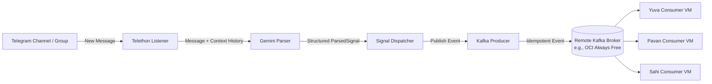

# Telegram Signal Producer

The **Signal Producer** is an asynchronous ingestion and parsing service for algorithmic trading. It listens to selected Telegram channels/groups using Telethon, parses natural-language trading instructions into structured JSON schemas using Google Gemini GenAI, and publishes validated signals to Apache Kafka.

---

## Architecture



- **Telegram Listener**: Streams real-time messages from configured Telegram channels via MTProto.
- **Gemini Parser**: Uses Google Gemini to extract trading actions (`BUY`, `EXIT`, `CANCEL`), contract details (`NIFTY 24500 CE`), price conditions (`ABOVE`, `AT`, `BELOW`), stop-losses, and multi-targets.
- **Context Awareness**: Maintains a sliding memory window of recent channel messages to interpret follow-up messages (e.g., *"Exit at cost to cost"*, *"SL 220"*, *"Cancel"*).
- **Decoupled Kafka Backbone**: Publishes strictly to an external/remote Kafka cluster (e.g. OCI Always Free instance). No local Docker or ZooKeeper containers run on the producer VM.

---

## Kafka Event Schema

Actionable messages are published as JSON payloads keyed by contract symbol (e.g., `NIFTY_24500_CE`):

```json
{
  "is_trading_signal": true,
  "signal_type": "NEW_ORDER",
  "action": "BUY",
  "index": "NIFTY",
  "strike_price": 24500,
  "option_type": "CE",
  "order_condition": "ABOVE",
  "entry_price": 250,
  "trigger_price": 250,
  "stop_loss": 220,
  "target": [270, 290, 320],
  "target_expiry": null,
  "reasoning": "Breakout buy order above 250 with 3 targets",
  "raw_message": "Nifty 24500 CE ABV 250 TGT 270/290/320 SL 220",
  "timestamp": "2026-11-06T09:15:00+00:00",
  "_meta": {
    "event_id": "9611e616-aff8-445f-9097-1f1087782926",
    "published_at": "2026-11-06T09:15:01+00:00",
    "source": "telegram_gemini_extractor"
  }
}
```

---

## Configuration (`.env`)

Copy `deploy/deploy.env.example` or create `.env` in the repository root:

| Variable | Description |
| :--- | :--- |
| `TELEGRAM_API_ID` | Telegram API App ID from [my.telegram.org](https://my.telegram.org). |
| `TELEGRAM_API_HASH` | Telegram API App Hash. |
| `TELEGRAM_PHONE` | Account phone number (with country code, e.g. `+91xxxxxxxxxx`). |
| `TELEGRAM_SESSION_NAME` | Session file name (defaults to `kotak_trader_session`). |
| `TELEGRAM_CHANNELS` | Comma-separated channel IDs/usernames to monitor (e.g., `-1001234567890,@signalchannel`). |
| `GEMINI_API_KEY` | Google Gemini API Key. |
| `GEMINI_MODEL` | Gemini model name (e.g., `gemini-2.5-flash`). |
| `KAFKA_BOOTSTRAP_SERVERS` | Remote Kafka address (e.g. `<OCI_KAFKA_PUBLIC_IP>:9092`). |
| `KAFKA_TOPIC_SIGNALS` | Kafka topic name (defaults to `kotak_trading_signals`). |

---

## Telegram Authentication

Before running the service on a new machine or VM, authenticate Telegram once interactively:

```bash
# 1. Activate environment
source .venv/bin/activate

# 2. Run interactive authentication
python main.py --login-telegram
```
Enter your phone number, the verification code sent to your Telegram app, and your 2FA password (if enabled). This generates the local `kotak_trader_session.session` file.

To test Gemini parsing locally without publishing to Kafka:
```bash
python main.py --test-signal "Nifty 24500 ce abv 250 tgt 270/290 sl 220"
```

---

## Automated Deployment (GitHub Actions)

Deployments are triggered on push to `main` via [`.github/workflows/deploy.yml`](.github/workflows/deploy.yml) or manually via **Run workflow**.

### GitHub Repository Secrets & Variables
Configure in **Settings $\rightarrow$ Secrets and variables $\rightarrow$ Actions**:
- `GCP_VM_HOST`: Public IP of the Producer VM.
- `GCP_VM_USER`: SSH user (e.g., `pawanbudati`).
- `GCP_VM_SSH_KEY`: SSH private key.
- `GCP_VM_KNOWN_HOSTS`: Verified SSH host key line.
- `LOG_CLEANUP_CRON` *(Optional)*: Cron schedule for daily log cleanup and service restart (defaults to `0 8 * * *` / 8:00 AM daily).

### Automated Features:
1. **Zero Docker Overhead**: Removed local container initialization; connects to external Kafka broker.
2. **Self-Healing Dependencies**: Auto-installs `python3-venv` and `python3-pip` if missing.
3. **Daily Pre-Market Restart & Log Cleanup**: Automatically registers a root cron job in `/etc/cron.d/journal-log-cleanup`:
   ```cron
   0 8 * * * root journalctl --rotate && journalctl --vacuum-time=1s && systemctl restart neo-tel-signal-producer.service >/dev/null 2>&1
   ```
   Ensures fresh socket connections, clean Telegram sessions, and zero disk bloat every morning at 8:00 AM IST.

---

## Manual Deployment (No GitHub Actions)

Deploy directly from your machine using the included deployment scripts:

### From Windows (PowerShell):
```powershell
cd producer

# Deploy to producer VM:
.\deploy\manual_deploy.ps1

# Or pass host/user directly:
.\deploy\manual_deploy.ps1 -VmHost "34.93.x.x" -VmUser "pawanbudati"
```

### From Linux / macOS / Git Bash:
```bash
cd producer
./deploy/manual_deploy.sh
```

---

## Service Management & Troubleshooting

```bash
# Service status
sudo systemctl status neo-tel-signal-producer

# Live streaming logs
sudo journalctl -u neo-tel-signal-producer -f

# Restart service
sudo systemctl restart neo-tel-signal-producer

# Test Kafka broker connectivity from VM
nc -zv <OCI_KAFKA_PUBLIC_IP> 9092
```
