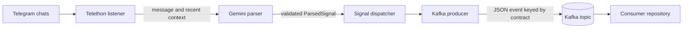

# Telegram Signal Producer

The producer listens to selected Telegram chats, asks Google Gemini to turn messages into structured trading signals, and publishes actionable signals to Apache Kafka. It does not connect to Kotak Neo or place orders.

## Architecture



The producer filters incoming messages to `TELEGRAM_CHANNELS` when configured. It keeps recent messages in memory to help interpret follow-up instructions. Gemini returns structured fields, which are validated as a `ParsedSignal`. Non-actionable messages are not published. The Kafka producer sends actionable events with `acks=all` and idempotence enabled, using the contract key (for example, `NIFTY_22500_CE`) as the Kafka record key.

The producer and consumer are independently deployed applications. Their contract is the Kafka topic and JSON event shape. Keep the topic name and signal fields compatible when changing either repository.

### Kafka event

An event contains the fields below (some signal fields may be `null`):

```json
{
  "is_trading_signal": true,
  "signal_type": "NEW_ORDER",
  "action": "BUY",
  "index": "NIFTY",
  "strike_price": 22500,
  "option_type": "CE",
  "order_condition": "ABOVE",
  "entry_price": 50,
  "trigger_price": 50,
  "stop_loss": 45,
  "target": null,
  "target_expiry": null,
  "reasoning": "Parsed from the source message",
  "raw_message": "Buy NIFTY 22500 CE above 50 SL 45",
  "timestamp": "2026-10-18T09:30:00+00:00",
  "_meta": {
    "event_id": "a-unique-event-id",
    "published_at": "2026-10-18T09:30:01+00:00",
    "source": "telegram_gemini_extractor"
  }
}
```

The Kafka key is `NIFTY_22500_CE` in this example. Events for a given key are ordered within their Kafka partition. The consumer reads the event fields and ignores `_meta` when reconstructing the signal model.

## Requirements

- Python 3.10 or newer.
- Telegram API ID and hash, plus an account that can read the selected chats.
- Google Gemini API key.
- A reachable Kafka broker. For a local single-machine setup, Docker is convenient.
- Linux for the included VM deployment scripts; local development also works in Windows PowerShell.

## Local setup

### 1. Start Kafka locally (optional)

If no broker is already running, start a local single-node broker:

```bash
docker run -d --name trading-kafka --restart unless-stopped \
  -p 9092:9092 \
  -v trading-kafka-data:/tmp/kraft-combined-logs \
  apache/kafka:4.1.2
```

For local producer development, the default broker address is `localhost:9092`. If the container already exists, use `docker start trading-kafka`.

### 2. Create the Python environment

Windows PowerShell:

```powershell
py -m venv .venv
.\.venv\Scripts\Activate.ps1
python -m pip install -r requirements.txt
Copy-Item .env.example .env
```

Linux or macOS:

```bash
python3 -m venv .venv
source .venv/bin/activate
python -m pip install -r requirements.txt
cp .env.example .env
```

Edit `.env` and set the required Telegram and Gemini values. The settings loader reads this file from the repository root.

### 3. Authenticate the Telegram account

Run this once from the producer repository with the virtual environment active:

```bash
python main.py --login-telegram
```

Complete Telegram's verification prompts. The command creates the session file named by `TELEGRAM_SESSION_NAME` (default `kotak_trader_session.session`) in this repository. Treat the session file like a password. Do not commit or share it.

### 4. Run the producer

```bash
python main.py
```

The process stays connected to Telegram and Kafka until stopped. Use `Ctrl+C` for a clean local shutdown.

To check Gemini parsing on one message without publishing it to Kafka:

```bash
python main.py --test-signal "buy nifty 22500 ce above 50 sl 45"
```

This calls Gemini and may incur API usage; it does not send a Kafka event or place an order.

Optional CLI overrides:

```text
--kafka-servers ADDR   Override KAFKA_BOOTSTRAP_SERVERS
--kafka-topic NAME    Override KAFKA_TOPIC_SIGNALS
```

## Configuration

Copy `.env.example` to `.env`. Keep actual values private.

| Variable | Purpose |
| --- | --- |
| `TELEGRAM_API_ID` | Telegram application ID. Required. |
| `TELEGRAM_API_HASH` | Telegram application hash. Required. |
| `TELEGRAM_PHONE` | Phone number for the Telegram account used to log in. |
| `TELEGRAM_SESSION_NAME` | Session filename without `.session`; defaults to `kotak_trader_session`. |
| `TELEGRAM_CHANNELS` | Comma-separated usernames, invite links, or chat IDs to monitor. Restrict this to intended signal chats. If empty, the listener processes all incoming channel/group messages visible to the account. |
| `GEMINI_API_KEY` | Google Gemini API key. Required. |
| `GEMINI_MODEL` | Gemini model name; defaults to the value in `.env.example`. |
| `GEMINI_TEMPERATURE` | Parsing temperature. |
| `GEMINI_TIMEOUT_SECONDS` | Gemini request timeout. |
| `MESSAGE_HISTORY_CONTEXT_SIZE` | Number of prior messages included as parser context. |
| `KAFKA_BOOTSTRAP_SERVERS` | Kafka bootstrap address. Defaults to `localhost:9092`. |
| `KAFKA_TOPIC_SIGNALS` | Signal topic; defaults to `kotak_trading_signals`. Must match the consumer. |
| `KAFKA_SECURITY_PROTOCOL` | Kafka protocol, normally `PLAINTEXT` for the included container. |
| `KAFKA_SASL_MECHANISM`, `KAFKA_SASL_USERNAME`, `KAFKA_SASL_PASSWORD` | Optional credentials for a broker configured for SASL. Both sides must use matching broker security settings. |

The parser can recognize new, modify, cancel, close, ignore, or non-signal messages. It receives the current Telegram message and a bounded amount of recent context. Its context buffer is in memory and resets when the producer restarts.

## Deploy to GCP with GitHub Actions

The workflow in `.github/workflows/deploy.yml` deploys on pushes to `main` that change application/deployment files, or can be started manually from **Actions → Deploy producer → Run workflow**. Markdown-only changes do not deploy. Deployment syncs the repo, ensures Kafka is running, installs Python requirements, and restarts the producer's systemd service.

### GitHub Actions settings

In **Settings → Secrets and variables → Actions**, configure:

**Secrets**

- `GCP_VM_SSH_KEY`: private key for the VM deployment account.
- `GCP_VM_KNOWN_HOSTS`: verified `known_hosts` line for the VM, including the host/IP used by SSH.
- `GCP_VM_HOST`: VM SSH IP or DNS name. This can also be a repository variable.
- `GCP_VM_USER`: VM Linux account. This can also be a repository variable.

**Optional variables**

- `GCP_VM_SSH_PORT`: SSH port; defaults to `22`.
- `PRODUCER_DEPLOY_PATH`: defaults to `/home/<GCP_VM_USER>/apps/neo-tel-signal-producer`.
- `KAFKA_ADVERTISED_HOST`: broker address returned to Kafka clients; defaults to the producer VM's private IP obtained from the GCP metadata server.

### Prepare the producer VM

Before the first deploy, create the directory and VM-local `.env`. The deployment intentionally preserves `.env`, virtual environments, logs, and Telegram session files.

```bash
mkdir -p "$HOME/apps/neo-tel-signal-producer"
```

From a local checkout, copy the example to the VM, then edit it there. Set the variables to your SSH user, host, and deployment path:

```powershell
$vmUser = "YOUR_LINUX_USER"
$vmHost = "YOUR_VM_IP_OR_DNS"
$deployPath = "/home/$vmUser/apps/neo-tel-signal-producer"
ssh "$vmUser@$vmHost" "mkdir -p '$deployPath'"
scp .env.example "${vmUser}@${vmHost}:$deployPath/.env"
ssh "$vmUser@$vmHost" "chmod 600 '$deployPath/.env' && nano '$deployPath/.env'"
```

After that, run the producer workflow once. It syncs the code and starts Kafka, then the producer service setup will stop if the Telegram session file is not present. SSH to the VM and create the session there:

Connect to the VM (replace the values above):

```powershell
ssh "$vmUser@$vmHost"
```

Then run these commands on the VM:

```bash
cd "$HOME/apps/neo-tel-signal-producer"
python3 -m venv .venv
.venv/bin/python -m pip install -r requirements.txt
.venv/bin/python main.py --login-telegram
```

Complete Telegram verification. Then rerun the producer workflow; it will install/update dependencies and start the service. Keep the session file at the configured path. The GitHub workflow never uploads local `.env` or `.session` files.

The deploy account needs SSH access, Python 3, `curl`, and passwordless `sudo` for package installation, Docker, and systemd operations. The workflow attempts to install `rsync` and Docker if absent, using `apt-get`, `dnf`, or `yum`.

### Kafka container and network

The producer workflow creates or starts `trading-kafka` on the producer VM. A new container uses the pinned Apache Kafka image `apache/kafka:4.1.2`, a persistent Docker volume named `trading-kafka-data`, and a Docker restart policy. It advertises the producer VM's private IP on port `9092`. An existing `trading-kafka` container is started if stopped and left unchanged if already running.

The topic is created automatically by the broker when enabled. To create it explicitly on the producer VM, run:

```bash
sudo docker exec trading-kafka /opt/kafka/bin/kafka-topics.sh \
  --bootstrap-server localhost:9092 \
  --create --if-not-exists \
  --topic kotak_trading_signals \
  --partitions 3 --replication-factor 1
```

For the consumer on another GCP VM:

1. Set the consumer's `KAFKA_BOOTSTRAP_SERVERS` to `<producer-private-ip>:9092` in its VM-local `.env`.
2. Ensure both apps use the same `KAFKA_TOPIC_SIGNALS` and compatible Kafka security settings.
3. Add a GCP VPC firewall ingress rule for TCP `9092`, limited to the consumer VM's private IP or the smallest required private subnet. Do not expose plaintext Kafka to the public internet.

The producer itself can keep `KAFKA_BOOTSTRAP_SERVERS=localhost:9092`; Kafka metadata directs it to the broker's private address after the initial connection.

### Service and logs

The deployment installs and enables `neo-tel-signal-producer.service`:

```bash
sudo systemctl status neo-tel-signal-producer
sudo systemctl restart neo-tel-signal-producer
sudo journalctl -u neo-tel-signal-producer -f
sudo journalctl -u neo-tel-signal-producer --since today
```

Kafka container logs:

```bash
sudo docker ps --filter name=trading-kafka
sudo docker logs -f trading-kafka
```

## Security and operating notes

- The producer sends Telegram message text and recent context to Gemini. Make sure that data handling is appropriate for the chats you monitor.
- Keep Telegram credentials, Gemini keys, `.env`, and Telegram session files out of Git. `.gitignore` excludes them.
- An empty `TELEGRAM_CHANNELS` setting means all incoming channel/group messages available to the Telegram account can be processed.
- The producer does not execute orders. The consumer does; verify consumer configuration and account settings separately.
- For a remote Kafka broker, use authenticated/encrypted connectivity and configure matching Kafka security values on producer and consumer.

## Troubleshooting

| Symptom | Check |
| --- | --- |
| Telegram login or session error | Confirm Telegram API values, phone number, and that the session file exists on the VM with the configured session name. |
| No messages processed | Confirm the account can see the chats and `TELEGRAM_CHANNELS` entries resolve to the intended chat IDs/usernames. |
| Gemini authentication or parsing errors | Check `GEMINI_API_KEY`, model availability, timeout, and producer logs. |
| Kafka connection refused | Check `sudo docker ps`, `sudo docker logs trading-kafka`, producer `.env`, and that port `9092` is listening. |
| Consumer VM cannot connect | Use the producer VM's private IP in consumer `.env`; check VPC routing/firewall and Kafka advertised host. |
| GitHub deploy fails | Review the failed Actions step, repository secrets/variables, VM SSH access, `sudo -n` permissions, and systemd/container logs. |
